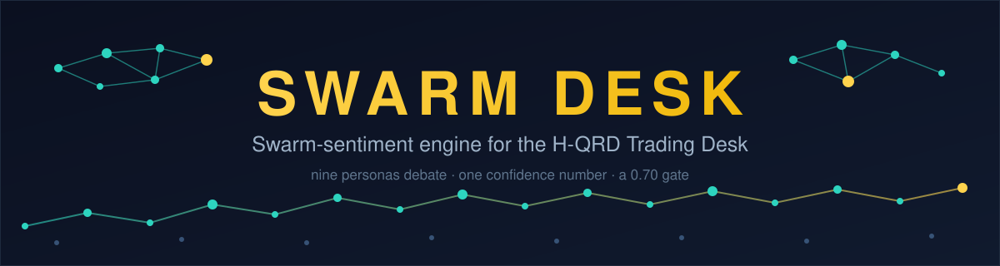
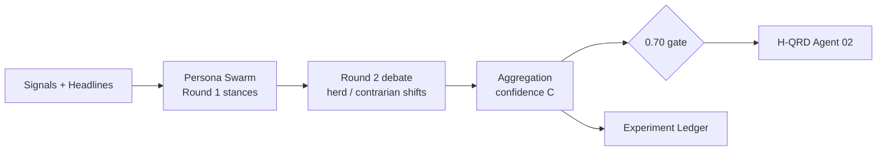
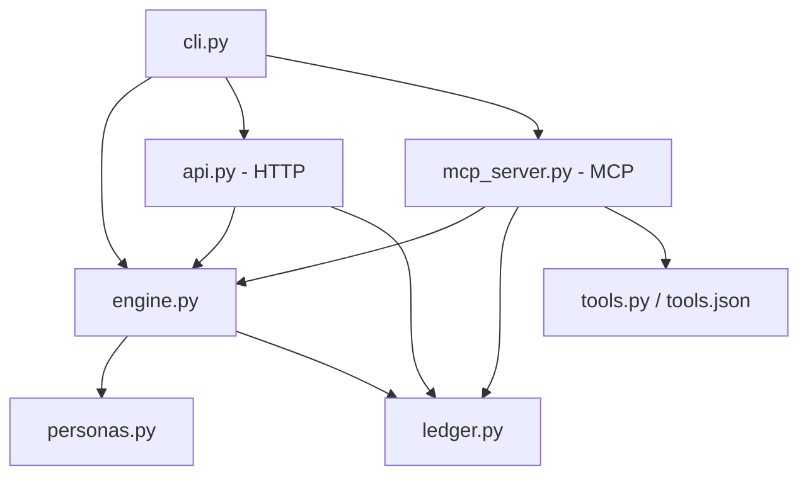

<p align="center">
  
</p>

<p align="center">
  <a href="LICENSE"></a>
  
  
  
  
  <a href="https://github.com/EdgeAgent/swarm-desk/stargazers"></a>
  <a href="https://github.com/EdgeAgent/swarm-desk/network/members"></a>
</p>

<p align="center">
  
</p>

**A swarm of nine persona agents debates an asset for two rounds — and hands your trading desk one confidence number it can gate on.**

## Why

The H-QRD Trading Desk runs a 4-agent pipeline. Agent 02 — the
Fundamental & Momentum Analyst — prunes any asset whose catalyst
confidence is **< 0.70**. But nothing was actually producing that
confidence number: Agent 02 had a gate with no feed.

Swarm Desk is the feed. Feed it an asset's signals and headlines, and
nine personas — bull and bear analysts, a momentum trader, a value
investor, a risk manager, a retail-sentiment watcher, a contrarian, a
news hawk and a quant — form stances, argue about them for a round,
and get aggregated into a single confidence in 0..1 plus the gate call:
`KEEP` or `PRUNE-CANDIDATE`.

*Pattern inspiration: the swarm-prediction pattern popularised by
MiroFish — this is an original, clean-room implementation (MIT), with
no code, text, or affiliation shared.*

## Quickstart — zero keys, zero network

```bash
pip install -e .          # or just run from the repo root
swarm-desk demo           # the full 12-asset universe
```

Or without installing:

```bash
python -m swarm_desk demo
python -m swarm_desk run --asset NVDA --momentum 0.8 --volatility 0.3 \
    --headlines "Chipmaker beats estimates as AI demand surges"
```

No API keys. No accounts. The default engine is deterministic signal
rules on the Python standard library alone — numpy/pandas aren't even
required.

## Demo output

Real output from `swarm-desk demo` (seed 42, built-in sample data):

| Asset | Stance | Bull% | Bear% | Conf | Verdict | Gate |
|---|---|---|---|---|---|---|
| NVDA | +0.52 | 89% | 11% | **0.73** | BULLISH | **KEEP** |
| AMZN | +0.18 | 89% | 11% | 0.44 | LEAN BULLISH | PRUNE-CANDIDATE |
| TSLA | −0.05 | 33% | 67% | 0.29 | NEUTRAL | PRUNE-CANDIDATE |
| MSFT | +0.44 | 89% | 11% | 0.68 | BULLISH | PRUNE-CANDIDATE |
| META | +0.03 | 78% | 22% | 0.26 | NEUTRAL | PRUNE-CANDIDATE |
| GOOGL | +0.23 | 89% | 11% | 0.47 | LEAN BULLISH | PRUNE-CANDIDATE |
| AAPL | +0.38 | 89% | 11% | 0.63 | BULLISH | PRUNE-CANDIDATE |
| JPM | +0.44 | 89% | 11% | 0.63 | BULLISH | PRUNE-CANDIDATE |
| V | +0.38 | 89% | 11% | 0.59 | BULLISH | PRUNE-CANDIDATE |
| XOM | +0.17 | 78% | 22% | 0.35 | LEAN BULLISH | PRUNE-CANDIDATE |
| JNJ | +0.46 | 89% | 11% | 0.64 | BULLISH | PRUNE-CANDIDATE |
| PG | +0.57 | 89% | 11% | **0.72** | BULLISH | **KEEP** |

**2 KEEP / 10 PRUNE-CANDIDATE.** That's the gate doing its job — 0.70
is a high bar, and a swarm that keeps everything isn't a filter.

## Plug it into anything

| Door | One-liner |
|---|---|
| **MCP** | `swarm-desk mcp` — a stdio MCP server with 4 tools, for Hermes / Claude Desktop / Cursor (`pip install "swarm-desk[mcp]"`) |
| **HTTP** | `swarm-desk serve --port 8799` — `POST /verdict`, `GET /personas`, `POST /outcome`, stdlib only |
| **Python** | `from swarm_desk import run_swarm` — verdict in-process, no server at all |

Copy-paste configs for each door (Hermes MCP block, generic MCP
client JSON, curl, OpenAI tools) live in
[docs/INTEGRATIONS.md](docs/INTEGRATIONS.md). The four tools —
`run_swarm`, `check_gate`, `list_personas`, `score_outcome` — are
defined once in `swarm_desk/tools.py` and rendered to both OpenAI
function-calling and MCP formats (`swarm_desk/tools.json`), so the
formats can never drift apart.

## How it plugs into H-QRD

```
Agent 01 (Data Scout)  ->  signals + headlines per asset
Agent 02 (Analyst)     ->  swarm_desk.run_swarm(asset, signals, headlines)
                           confidence >= 0.70  ->  asset survives
                           confidence <  0.70  ->  pruned
Agent 03 (Quantum)     ->  optimises over the survivors only
Agent 04 (REA Gate)    ->  risk-checks the final basket
```

Every swarm run — kept or pruned — is also written to the experiment
ledger, so Agent 02's filter itself accumulates a track record.

## The Math (condensed)

Full derivation, formula-for-formula against the code:
[docs/MATH.md](docs/MATH.md).

- **Round 1 stance:** $s_i = \text{clip}(\sum_k w_{ik} x_k + b_i + \varepsilon_i,\ -1,\ 1)$, with per-persona weights $w_{ik}$, bias $b_i$, and seeded noise $\varepsilon_i \sim \mathcal{N}(0, \sigma_i)$. Volatility enters inverted as *calm* $= 1 - 2\cdot\text{volatility}$.
- **Headlines:** $h(t) = \frac{P - N}{P + N}$ over positive/negative keyword hits, averaged across headlines.
- **Round 2 debate:** $s_i \leftarrow \text{clip}(s_i + h_i(\mu - s_i) + \varepsilon_i',\ -1,\ 1)$ — herders ($h_i > 0$) move toward the swarm mean $\mu$, the contrarian ($h_i = -0.60$) moves against it.
- **Aggregation:** with majority conviction $M$ (mean stance of the winning side) and consensus $A = |B^+ - B^-|$:

$$C = \text{clip}\left( 0.65 \cdot M + 0.35 \cdot A,\ 0,\ 1 \right)$$

- **The gate:** $C \ge 0.70 \Rightarrow$ `KEEP`, else `PRUNE-CANDIDATE`.

Deterministic end to end: same inputs + same seed = same verdict,
byte for byte.

## Architecture





Component table and design rules: [docs/ARCHITECTURE.md](docs/ARCHITECTURE.md).

## The Experiment Ledger

Every run appends one JSONL entry (`data/ledger.jsonl`): timestamp,
asset, inputs, full verdict, gate call — and an `outcome` field that
starts as `null`. Later, `score_outcome` (CLI door: HTTP `/outcome` or
the MCP tool) fills it in with what actually happened.

This is REA discipline applied to the signal itself: **a prediction is
a hypothesis, the ledger is the experiment log, and the swarm earns
trust only from scored results** — failures included, nothing deleted.

## Repo structure

```
swarm-desk/
├── assets/
│   ├── banner.svg            # README banner (SVG, text-based)
│   └── icon.svg              # hexagon node-cluster mark
├── docs/
│   ├── ARCHITECTURE.md       # diagrams + component table
│   ├── INTEGRATIONS.md       # MCP / HTTP / Python plug-in guides
│   └── MATH.md               # every formula, as implemented
├── examples/
│   └── sample_signals.json   # seeded sample inputs for the demo
├── swarm_desk/
│   ├── __init__.py           # public API: run_swarm, gate_for, PERSONAS
│   ├── __main__.py           # python -m swarm_desk
│   ├── api.py                # HTTP API (stdlib http.server)
│   ├── cli.py                # demo / run / serve / mcp commands
│   ├── engine.py             # the swarm: debate, aggregation, gate
│   ├── ledger.py             # JSONL experiment ledger + outcome scoring
│   ├── llm.py                # optional LLM headline blend (flag-gated)
│   ├── mcp_server.py         # MCP stdio server (optional mcp extra)
│   ├── personas.py           # the 9 agent archetypes
│   ├── tools.json            # tool schemas: OpenAI + MCP renderings
│   └── tools.py              # single source for the tool schemas
├── tests/                    # pytest suite (30 tests, no network)
├── LICENSE                   # MIT
├── pyproject.toml            # packaging + console script + mcp extra
└── README.md
```

| File | Purpose |
|---|---|
| `swarm_desk/engine.py` | Feature building, two-round debate, aggregation, gate |
| `swarm_desk/personas.py` | The 9 archetypes: weights, bias, noise, herd coefficient |
| `swarm_desk/ledger.py` | Append-only JSONL ledger; score outcomes later |
| `swarm_desk/tools.py` | The 4 tool definitions — one source, two formats |
| `swarm_desk/mcp_server.py` | MCP door (optional extra, guarded import) |
| `swarm_desk/api.py` | HTTP door — zero dependencies |
| `swarm_desk/cli.py` | `swarm-desk demo / run / serve / mcp` |
| `swarm_desk/llm.py` | Optional OpenAI-compatible headline read |
| `examples/sample_signals.json` | The demo's seeded universe |

## Roadmap

- **Outcome scoring reports** — turn the ledger into a scorecard:
  did KEEPs actually beat PRUNE-CANDIDATEs?
- **Live headline feed** — a real catalyst source feeding Agent 02's
  inputs instead of hand-passed headlines.
- **LLM debate mode** — personas arguing in natural language behind
  the existing `SWARM_LLM_*` config (the blend hook is already in).
- **Persona calibration** — fit weights/biases against the scored
  ledger instead of hand-set values.
- **mcp 2.x API port** — the MCP extra is pinned to `mcp>=1.0,<2.0`
  (the server uses the 1.x API); porting `mcp_server.py` to the
  mcp 2.x API is future work.

## Honesty / limits

- **Research and paper-trading tool only. Not financial advice.**
- **No proven predictive accuracy.** The swarm's confidence is a
  disciplined aggregation of hand-set persona rules over whatever
  signals you feed it. Until the ledger accumulates scored outcomes
  showing kept assets actually outperform pruned ones, treat the
  number as an organisational device, not an edge.
- **Sample data is sample data.** The demo's signals and headlines are
  seeded illustrations, not live market data.
- **The packaging is consumer-ready; the predictions are
  research-grade until the ledger proves otherwise.**
- Deterministic rules can be gamed by cherry-picked inputs — the
  ledger exists precisely so that can't hide.

## License

MIT — see [LICENSE](LICENSE). Original code; the swarm-prediction
pattern is an idea, and ideas are free.
