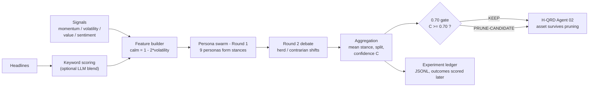
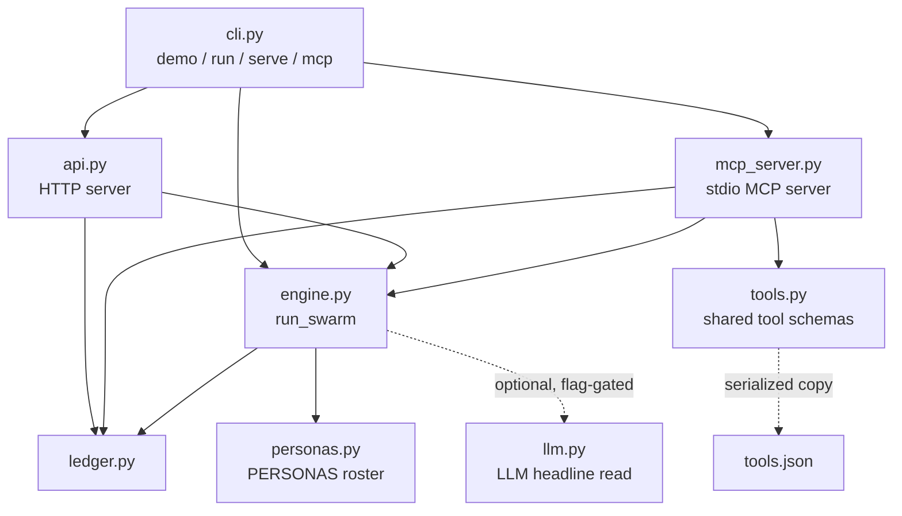

# Swarm Desk — Architecture

## System flow

Three doors lead into the same engine — a Python import, an MCP server,
and an HTTP API — and every door writes to the same ledger. See
[INTEGRATIONS.md](INTEGRATIONS.md) for how to use each one.

## Module map

## Component table

| Module | Responsibility | Key functions |
|---|---|---|
| `swarm_desk/personas.py` | The roster: 9 agent archetypes with documented reasoning styles (weights, bias, noise, herd coefficient). Pure data, no logic. | `PERSONAS`, `Persona`, `PERSONA_BY_NAME` |
| `swarm_desk/engine.py` | The swarm itself: feature building, headline keyword scoring, the two-round debate, aggregation, the 0.70 gate. Deterministic per (inputs, seed). | `run_swarm`, `aggregate`, `gate_for`, `label_for`, `headline_score`, `build_features`, `debate_shift` |
| `swarm_desk/ledger.py` | The experiment ledger (JSONL). Every run is appended with a null outcome; outcomes are scored in later. | `log_run`, `append_entry`, `read_entries`, `score_outcome` |
| `swarm_desk/llm.py` | Optional LLM headline read behind env config. Returns None on any problem so the engine falls back to keyword scoring. | `llm_headline_score`, `llm_configured` |
| `swarm_desk/tools.py` | One source of truth for the four tool schemas, rendered to OpenAI and MCP formats; `tools.json` is generated from it. | `TOOL_DEFINITIONS`, `openai_tools`, `mcp_tools` |
| `swarm_desk/mcp_server.py` | MCP stdio server (optional `mcp` extra). Dispatch logic is plain Python and importable without the package. | `handle_tool`, `build_tool_schemas`, `create_server`, `main` |
| `swarm_desk/api.py` | Zero-dependency HTTP API on `http.server`: `/verdict`, `/personas`, `/outcome`, `/health`. | `make_server`, `serve`, `verdict_for_payload`, `outcome_for_payload` |
| `swarm_desk/cli.py` | Command line: `demo`, `run`, `serve`, `mcp`; also the `swarm-desk` console script and `python -m swarm_desk`. | `main`, `build_parser`, `cmd_demo`, `cmd_run`, `cmd_serve`, `cmd_mcp` |

## Design rules

1. **Offline-first.** The core package imports nothing outside the
   standard library. The only optional dependency in the project is the
   `mcp` extra, and it is guarded.
2. **Deterministic.** All randomness comes from a `random.Random`
   seeded per (seed, asset). No global RNG, no wall-clock influence on
   verdicts. (Ledger timestamps are the only clock reads, and they do
   not affect the maths.)
3. **One engine, three doors.** Python, MCP and HTTP all call
   `run_swarm` and all log through `ledger.log_run`. A verdict cannot
   depend on which door you came through.
4. **One schema source.** `tools.py` defines the tools once; the
   OpenAI rendering, the MCP rendering, `tools.json`, and the MCP
   server all derive from it. A unit test enforces that the shipped
   JSON matches the source dicts.
5. **The ledger is the memory.** Predictions are written before
   outcomes exist. Scoring an outcome rewrites that entry in place —
   the prediction itself is never edited.
